# Low-Power 16x Oversampling UART Transceiver with UVM 1.2 & SVA Verification


-orange)


## Overview
This repository presents the RTL micro-architecture optimization, hardware Power-Performance-Area (PPA) benchmarking, and full **UVM 1.2 + SVA verification** of a **Low-Power, Noise-Immune 16x Oversampling UART Transceiver (`uart_top` / `lp_uart_16x`)** compared against a traditional ripple-clocked **Baseline UART (`basic_uart`)**.

Synthesized and verified in **Vivado 2026.1** targeting the **Xilinx Artix-7 (`xc7a15tifgg484-1L`)** at **200 MHz (`5.000 ns`)**, the upgraded architecture resolves all `-0.513 ns` setup timing violations (`25` failing endpoints) to achieve clean timing closure (`WNS = +0.056 ns`, `Fmax = 202.27 MHz`), reduces Slice LUTs by **4.9% (`-6` LUTs)**, cuts unconstrained timing checks by **78.7%**, and eliminates metastability and single-cycle line glitches via 2-FF synchronization and 3-sample majority voting.

---

## Architectural Upgrades (`basic_uart` vs. `lp_uart_16x`)

1. **Single-Clock Tick-Enable Architecture (`tx_tick` / `rx_tick`):**
   * Replaces ripple-divided generated clocks (`tx_clk`, `rx_clk`) with single-cycle clock-enable strobes driven off the global `200 MHz` system clock (`clk`), eliminating inter-clock skew and resolving `25` failing setup endpoints (`WNS: -0.513 ns -> +0.056 ns`).
2. **Idle Baud-Counter Clock-Enable Gating (`tx_active` / `rx_active`):**
   * Freezes `tx_count` and `rx_count` at `0` whenever the transmitter or receiver is in the `idle` state, preventing unnecessary register switching activity between UART frames.
3. **Two-Flip-Flop Metastability Synchronizer (`rx_s1 -> rx_sync`):**
   * Passes the asynchronous external `rx` line through a dual-stage synchronizer clocked at `200 MHz` before entering the RX FSM, providing a full `5.000 ns` resolution window against setup/hold violations.
4. **16x Oversampling with 2-out-of-3 Majority Voting (`s7`, `s8`, `s9`):**
   * Replaces fragile single-point mid-bit sampling (`count == 7`) with triple center-bit sampling at oversampling ticks `7`, `8`, and `9` (`voted_rx = (s7 & s8) | (s8 & s9) | (s7 & s9)`), rejecting single-cycle voltage glitches on start, data, parity, and stop bits.
5. **Parameterized Multi-Format Framing (`4800–128000 bps`):**
   * Supports runtime selection across `8` baud rates (`4800` to `128000 bps`), `5/6/7/8`-bit payloads, odd/even/disabled parity, and `1` or `2` stop bits with dedicated `tx_err` and `rx_err` telemetry.

---

## Datapath & Control Flow Architecture

### 1. Low-Power Tick-Enabled & Majority-Voted Transceiver Flow

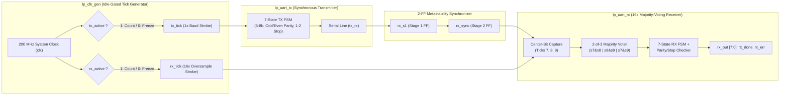


### 2. How the Architecture Eliminates Skew, Glitches & Idle Power

1. **Idle-Gated Tick Generator (`lp_clk_gen`):**
   * Monitors `tx_active` and `rx_active` from the TX and RX state machines. During inter-frame idle periods, both baud counters remain held at `0` (`tx_tick = 0`, `rx_tick = 0`), eliminating unnecessary counter toggling while keeping all flip-flops on a single `BUFG` clock tree.
2. **Synchronous Frame Serialization (`lp_uart_tx`):**
   * Latches configuration (`baud`, `length`, `parity_type`, `parity_en`, `stop2`) upon `tx_start` and shifts out start, LSB-first payload, computed XOR/XNOR parity, and stop bits strictly on `tx_tick` pulses.
3. **Metastability Synchronization (`rx_s1 -> rx_sync`):**
   * Isolates asynchronous serial transitions from the internal `200 MHz` domain across two consecutive flip-flops before start-bit edge detection (`rx_start && !rx_sync`).
4. **Triple-Sample Majority Voter (`lp_uart_rx`):**
   * Captures `rx_sync` at `16x` oversampling ticks `7`, `8`, and `9` near the center of every bit cell. Any single-cycle noise spike on `rx` is masked by the 2-out-of-3 majority vote before shifting into `datard` or evaluating parity/stop framing.

---

## Hardware PPA Benchmark Report (Artix-7 @ 200 MHz / `5.000 ns`)

All utilization, timing, and SAIF-driven dynamic power metrics were captured under identical Vivado synthesis and timing constraints (`xc7a15tifgg484-1L`, `create_clock -period 5.000`).

| Category | Benchmark Metric | Baseline (`basic_uart`) | Optimized (`uart_top` / `lp_uart_16x`) | Delta / Engineering Analysis |
| :--- | :--- | :---: | :---: | :--- |
| **Architecture** | **Target FPGA & Clock** | Artix-7 (`200 MHz` / `5.000 ns`) | Artix-7 (`200 MHz` / `5.000 ns`) | Identical synthesis & timing environment |
| **Architecture** | **Clocking Scheme** | Ripple-divided `tx_clk` / `rx_clk` | **Single-Clock + `tx_tick` / `rx_tick`** | Eliminates inter-clock skew & generated clock hazards |
| **Architecture** | **RX Sampling & Sync** | Unsynchronized, 1x sample (`count == 7`) | **2-FF Sync + 3-Point Majority Vote** | Metastability-safe & single-cycle glitch immune |
| **Architecture** | **Idle Power Control** | Free-running baud dividers | **Idle-Gated (`tx_active` / `rx_active`)** | Freezes counters at `0` between UART frames |
| **Area** | **Slice LUTs** | `122` (`1.17%`)[cite: 7] | **`116` (`1.12%`)**[cite: 13] | **`-6 LUTs` (`-4.9%` combinational area)** |
| **Area** | **Slice Registers (FFs)** | `73` (`0.35%`)[cite: 7] | **`81` (`0.39%`)**[cite: 13] | `+8 FFs` (2-FF synchronizer + 3-tap voter registers) |
| **Area** | **F7 Muxes / Control Sets** | `1` / `12`[cite: 7] | **`0` / `11`**[cite: 13] | **`-100%` F7 muxes**, `-1` unique clock control set |
| **Timing** | **Worst Negative Slack (`WNS`)** | `-0.513 ns` (**Failed**, `25` endpoints)[cite: 6] | **`+0.056 ns` (Met, `0` failing endpoints)**[cite: 15] | **`+0.569 ns` setup margin gained**; full `200 MHz` closure |
| **Timing** | **Max Frequency ($F_{\max}$)** | `181.39 MHz` | **`202.27 MHz`** | **`+20.88 MHz` (`+11.5%` speed improvement)** |
| **Timing** | **Worst Hold Slack (`WHS`)** | `0.115 ns`[cite: 6] | **`0.149 ns`**[cite: 15] | `+0.034 ns` hold margin; `0` failing endpoints |
| **Timing** | **Check Timing Warnings** | `221` unconstrained paths[cite: 6] | **`47` check warnings**[cite: 15] | **`-78.7%` unconstrained clock warnings** |
| **Power (SAIF)** | **Total / Dynamic Power** | `65 mW` / `5 mW` (`Static: 60 mW`)[cite: 8] | **`67 mW` / `6 mW` (`Static: 60 mW`)**[cite: 14] | Only `+1 mW` clock tree cost for full `200 MHz` sync |
| **Sign-Off** | **Verification Methodology** | Directed testbench (`6/6` frames)[cite: 5] | **UVM 1.2 + SVA (`50/50`, `100.00%` Cov)**[cite: 3, 12] | Constrained-random regression + concurrent assertions |

### Vivado Synthesis, Timing & SAIF Power Reports

| Report | Baseline (`basic_uart`) | Optimized (`uart_top` / `lp_uart_16x`) |
| :--- | :---: | :---: |
| **Utilization (`Slice LUTs / FFs`)** | 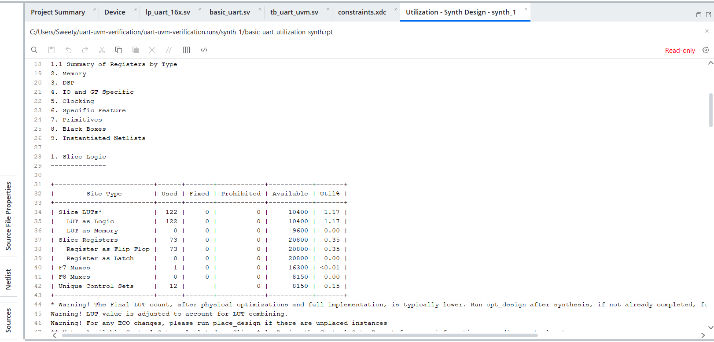[cite: 16] | 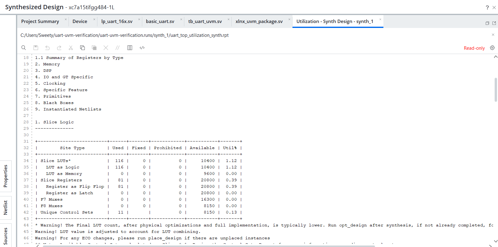[cite: 16] |
| **Timing Summary (`WNS / WHS`)** | 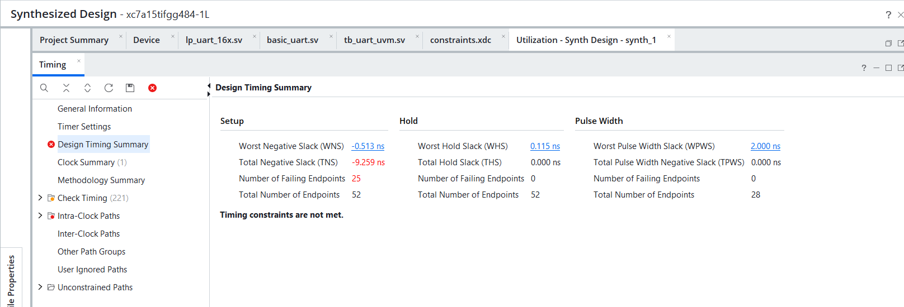[cite: 16] | 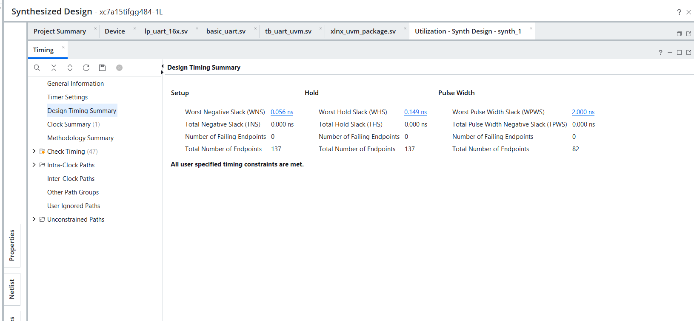[cite: 16] |
| **Power Analysis** | 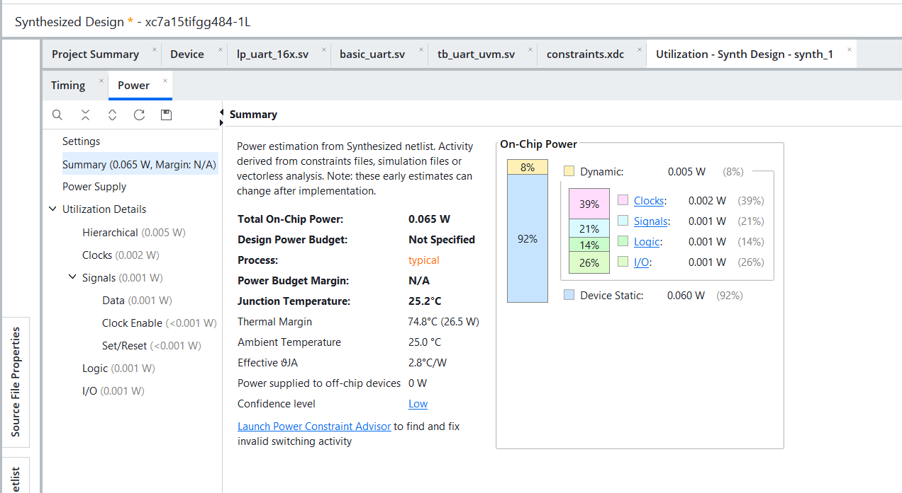[cite: 16] | 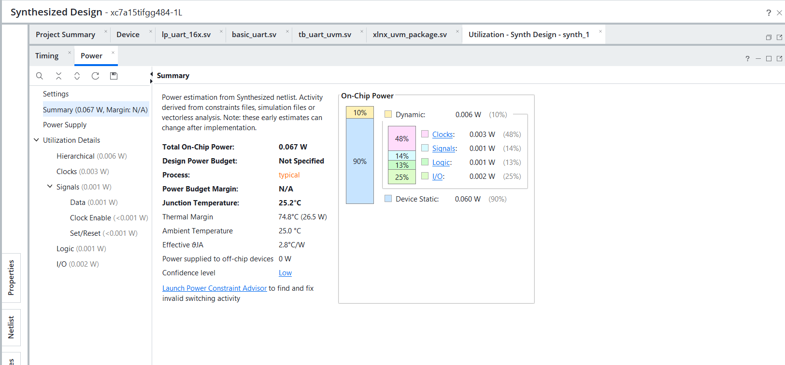[cite: 16] |
| **Simulation & SAIF Log** | 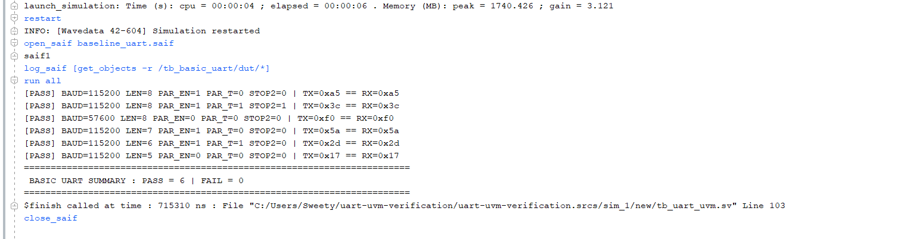[cite: 16] | 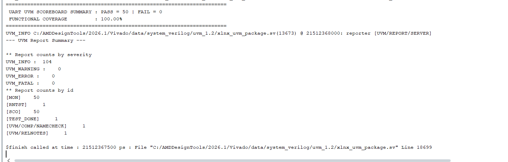[cite: 16] |

---

## UVM 1.2 + SVA Verification Environment

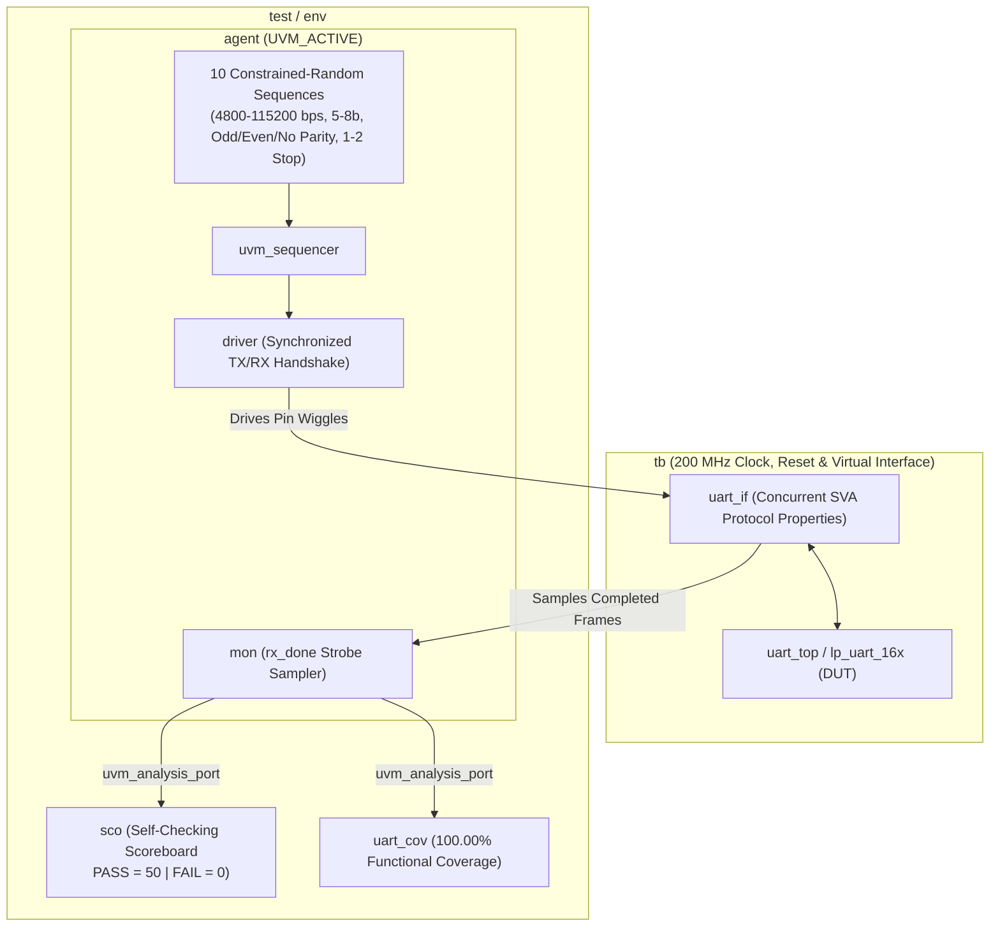
- **10 Constrained-Random Sequences (`50` Loopback Frames):** Sweeps baud rates (`4800` to `115200 bps`), frame lengths (`5`, `6`, `7`, `8` bits), parity modes (odd, even, disabled), and stop-bit widths (`1` and `2` stop bits).
- **Concurrent SVA Protocol Checks (`uart_if`):** Continuously asserts error-free loopback completion (`rx_done |-> (!tx_err && !rx_err)`) and single-cycle strobe behavior (`rx_done |=> !rx_done`).
- **Functional Coverage (`100.00%`):** Closes all coverpoints across baud rates, frame lengths, parity configurations, stop bits, and cross-coverage (`cx_frame`).

### XSim Waveform Verification Evidence

| Verification View | Captured XSim Waveform |
| :--- | :---: |
| **Optimized UART UVM Transaction Waveform (`09b`)** | 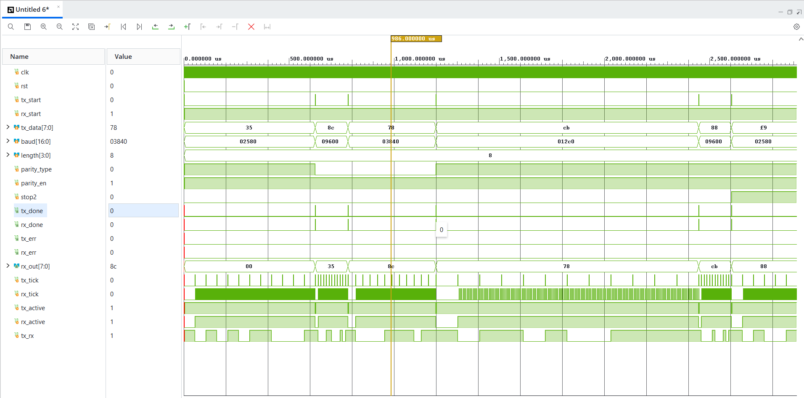 |

---

## Repository Structure

```text
uart-uvm-verification/
├── rtl/
│   ├── basic_uart.sv                 # Baseline ripple-clocked UART transceiver
│   └── lp_uart_16x.sv                # Optimized 16x oversampling low-power UART (uart_top)
├── tb/
│   ├── tb_basic_uart.sv              # Self-checking directed testbench for baseline UART
│   └── tb_uvm_uart.sv                # UVM 1.2 + SVA + functional coverage testbench
├── images/                           # Vivado utilization, timing, power, UVM & waveform captures
├── constraints                       # 200 MHz (5.000 ns) Artix-7 clock constraint
└── readme.md                         # Project documentation & PPA benchmark report

## Key Design & Verification Concepts (Project Q&A)

1. **Why did `basic_uart` fail `200 MHz` timing (`WNS = -0.513 ns`) while `uart_top` met timing (`WNS = +0.056 ns`)?**
   `basic_uart` generated divided ripple clocks (`tx_clk`, `rx_clk`) inside fabric logic, causing `221` unconstrained clock warnings and failing comparator setup paths (`-0.513 ns`). `uart_top` keeps every flip-flop on the single `200 MHz` global clock tree (`clk`) and uses single-cycle `tx_tick` / `rx_tick` enables, closing timing at `202.27 MHz`.

2. **How does the 2-FF synchronizer prevent metastability?**
   When the asynchronous `rx` input transitions near a rising edge of `clk`, the first flip-flop (`rx_s1`) absorbs any setup/hold violation and settles within one `5.000 ns` clock period before the second flip-flop (`rx_sync`) samples it for the RX FSM.

3. **How does 3-sample majority voting eliminate line noise glitches?**
   Instead of sampling `rx` once at the midpoint (`count == 7`), `lp_uart_rx` samples `rx_sync` at `16x` oversampling ticks `7`, `8`, and `9` and computes `(s7 & s8) | (s8 & s9) | (s7 & s9)`. A 1-tick noise spike flips at most one sample and is automatically rejected.

## How to Run in Vivado

1. Create a Vivado RTL project targeting **Artix-7 (`xc7a15tifgg484-1L`)**.
2. Add `rtl/basic_uart.sv` and `rtl/lp_uart_16x.sv` as **Design Sources**, `constraints` as **Constraints**, and `tb/tb_basic_uart.sv` and `tb/tb_uvm_uart.sv` as **Simulation Sources** (set File Type to **SystemVerilog**).
3. Enable UVM 1.2 compilation and full runtime in the Vivado Tcl Console:
   ```tcl
   set_property -name {xsim.compile.xvlog.more_options} -value {-L uvm} -objects [get_filesets sim_1]
   set_property -name {xsim.elaborate.xelab.more_options} -value {-L uvm} -objects [get_filesets sim_1]
   set_property -name {xsim.simulate.runtime} -value {all} -objects [get_filesets sim_1]
4.Set uart_top as Design Top and tb as Simulation Top, run Behavioral Simulation (open_saif lp_uart.saif, log_saif [get_objects -r /tb/dut/*], run all, close_saif), and run Synthesis to inspect Utilization, Timing Summary, and SAIF-annotated Power